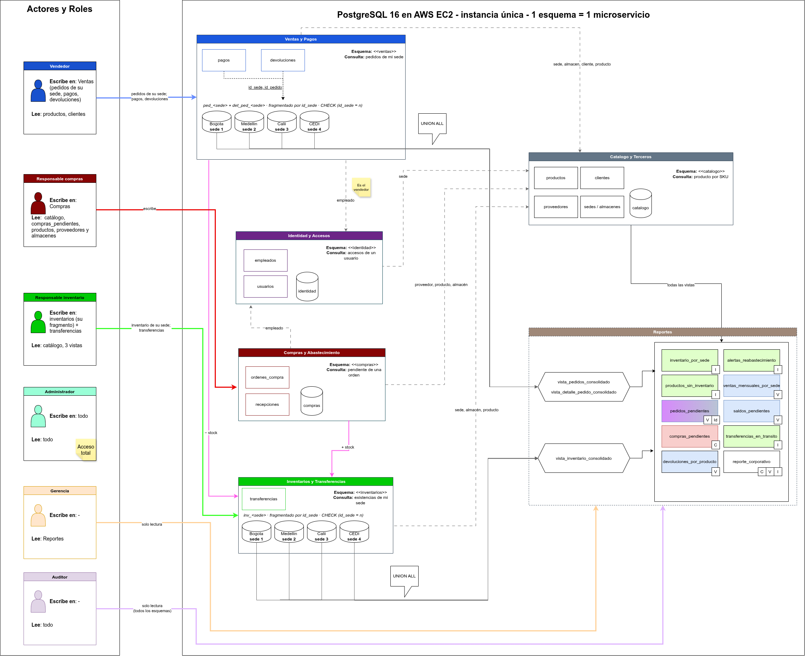

# bd-multisede-microservicios

Proyecto final de Bases de Datos (Universidad Distrital). TL;DR: una empresa con **4 sedes** (Bogotá, Medellín, Cali y un centro de distribución en Funza) necesita una base de datos donde cada sede vea lo suyo y la gerencia vea todo junto. Todo hecho en **PostgreSQL**.

## La idea en 30 segundos

- El enunciado pide pensarlo como **microservicios**: catálogo, compras, inventarios, ventas, identidad y reportes. Aquí cada "microservicio" es un **esquema** de PostgreSQL. Spoiler: es una simulación, todo vive en una sola base.
- **Inventarios y pedidos están partidos por sede**: hay una tabla física por sede (`inv_bogota`, `ped_cali`…), cada una con un `CHECK (id_sede = n)` para que nadie meta filas donde no van.
- Los **reportes** son puras vistas que juntan los pedazos con `UNION ALL`.
- Hay **roles de verdad**: el vendedor de Bogotá no puede ni ver los pedidos de Cali, la gerencia solo lee reportes, el auditor lee todo pero no toca nada.



## Correrlo

Necesitas PostgreSQL 12+ y `psql`.

```bash
createdb -U postgres comercializadora
psql -U postgres -d comercializadora -f run_all.sql
```

Eso borra todo, crea todo, mete los datos de prueba, corre las 20 consultas y las pruebas. Se puede correr las veces que quieras, siempre da lo mismo (semilla fija). Sí, salen varios `ERROR`: son las pruebas de rechazo (SKU duplicado, permisos denegados…) y es justo lo que se espera. La salida completa está en [`docs/evidencias.txt`](docs/evidencias.txt).

Más detalle en el [manual](docs/manual-ejecucion.md).

## Qué hay dónde

| Ruta | Qué es |
| --- | --- |
| `sql/01`–`06` | esquemas y tablas, un archivo por microservicio |
| `sql/07_datos.sql` | datos de prueba: 300 pedidos, 80 productos, 100 clientes… |
| `sql/08_vistas.sql` | vistas que unen los fragmentos + las 10 vistas obligatorias |
| `sql/09_roles.sql` | roles, usuarios y permisos |
| `sql/10_consultas.sql` | las 20 consultas que pide el enunciado |
| `sql/11_pruebas.sql` | pruebas de restricciones, fragmentos y permisos (todo con ROLLBACK, no ensucia nada) |
| `docs/enunciado.pdf` | lo que pide el profe. **La fuente de verdad** |
| `docs/` | análisis, reglas de negocio, manual, evidencias |

## En qué vamos

- [x] Base de datos completa: tablas, fragmentos, datos, vistas, roles, consultas y pruebas (todo pasa ✅)
- [x] Diagrama de arquitectura
- [ ] Modelo E-R conceptual y modelo relacional (hay que rehacerlos)
- [ ] Análisis de resultados, conclusiones y matriz de pruebas para el informe
- [ ] Backend sencillo (Python + FastAPI) y un front básico
- [ ] Desplegar en AWS EC2

## Si vas a ayudar, ojo con esto

- **Solo SQL visto en clase.** Nada de secuencias, `NULLIF`, `GREATEST`/`LEAST` ni particionamiento declarativo. `COALESCE` es la única excepción. Si necesitas algo raro, pregunta primero.
- Las relaciones **entre** microservicios no tienen FK a propósito (son "identificadores compartidos"). Se validan con `NOT EXISTS` en `11_pruebas.sql`.
- Ante la duda, manda el PDF del enunciado y lo que hacen los scripts, no lo que diga algún `.md` viejo.
