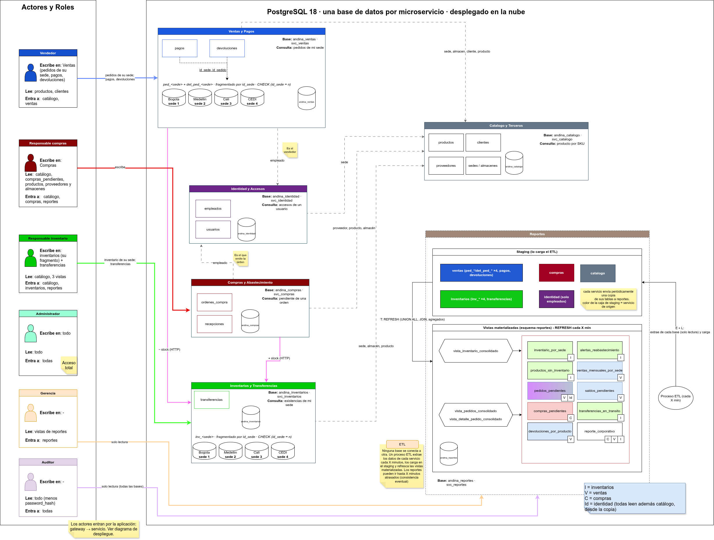
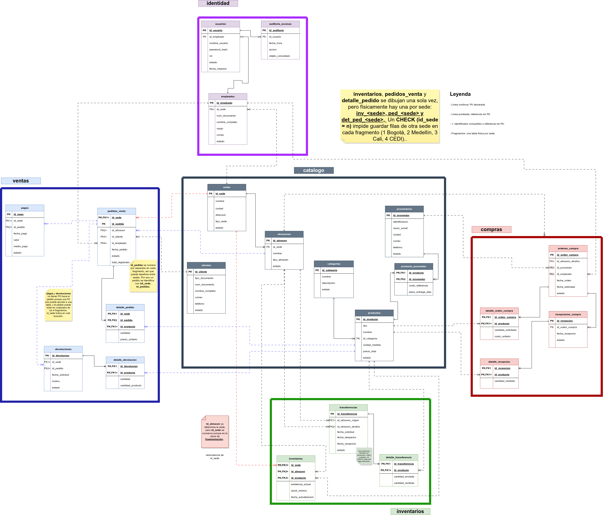

# bd-multisede-microservicios

Proyecto final de Bases de Datos. TL;DR: una empresa con **4 sedes** (Bogotá, Medellín, Cali y un centro de distribución en Funza) necesita una base de datos donde cada sede vea lo suyo y la gerencia vea todo junto. Todo hecho en **PostgreSQL** (el goat :3).

- El enunciado pide pensarlo como **microservicios**: catálogo, compras, inventarios, ventas, identidad y reportes. Aquí cada microservicio tiene **su propia base de datos** (`andina_catalogo`, `andina_ventas`…). En PostgreSQL una consulta no puede leer otra base, salvo con `dblink`; aquí solo reportes lo usa.
- **Inventarios y pedidos están partidos por sede**: hay una tabla física por sede (`inv_bogota`, `ped_cali`…), cada una con un `CHECK (id_sede = n)` para que nadie meta filas donde no van.
- **Reportes** trae los datos de las otras bases con **`dblink`** (una extensión de PostgreSQL que deja consultar otra base) y los guarda en **vistas materializadas**, que se refrescan cada X minutos. Es la versión simple de explicar: rompe un poco el aislamiento entre servicios, porque reportes sí se conecta a las otras bases. La versión sin `dblink` (ETL por CSV) está en la rama `feat/microservicios-reales`.
- Hay **roles de verdad**: el vendedor de Bogotá no puede ni ver los pedidos de Cali, la gerencia solo entra a la base de reportes, el auditor lee todo pero no toca nada. Cada servicio tiene además su usuario técnico (`svc_ventas`…) que solo entra a su base.





## Ejecucion

Necesitas PostgreSQL 17 o superior (probado en la 18), con la extensión `dblink` (viene en el paquete *contrib*), y `psql`:

Cada microservicio corre en **su propia instancia de PostgreSQL** (6 en total). En tu computador se levantan sin Docker:

```bash
scripts/instancias_locales.sh iniciar        # levanta las 6 instancias (puertos 5441 a 5446)
cp config/local.env.example config/local.env
scripts/correr.sh config/local.env           # borra todo, crea todo, corre consultas y pruebas
```

Eso crea la base de cada instancia, mete los datos de prueba, crea los reportes (que traen los datos por `dblink`), corre las 20 consultas y las pruebas. Se puede correr las veces que quiera uno, siempre da lo mismo (semilla fija). Para desplegar en la nube (Neon), ver [`docs/despliegue.md`](docs/despliegue.md).

Sí, salen varios `ERROR`: son las pruebas de rechazo (SKU duplicado, permisos denegados, leer otra base…) y es justo lo que se espera. La salida completa está en [`docs/evidencias.txt`](docs/evidencias.txt).

Más detalle en el [manual](docs/manual-ejecucion.md).

## Estructura scripts

| Ruta | Qué es (cada carpeta tiene su README explicando el código) |
| --- | --- |
| `sql/README.md` | **empezar aquí**: el orden, las carpetas y los comandos de psql |
| `scripts/` | `instancias_locales.sh` (levanta las 6 instancias) y `correr.sh` (corre los scripts con la configuración de un ambiente) |
| `config/` | plantillas con la conexión de cada instancia (`local.env.example`, `neon.env.example`) |
| `sql/00_config/` | lee la configuración y arma la conexión de cada servicio |
| `sql/01_bases/` | borrar y crear la base de cada instancia |
| `sql/02_tablas/` | las tablas, un archivo por microservicio (con la fragmentación por sede) |
| `sql/03_dblink/` | instalar y quitar `dblink` para consultar otra base |
| `sql/04_datos/` | datos de prueba de cada servicio: 300 pedidos, 80 productos, 100 clientes… Totalmente generadas con IA :) |
| `sql/05_reportes/` | vistas materializadas de reportes y `refrescar.sql` (lo que se programa cada X minutos) |
| `sql/06_roles/` | roles, usuarios y permisos, un archivo por instancia, con la matriz de permisos |
| `sql/07_consultas/` | las 20 consultas que pide el enunciado |
| `sql/08_pruebas/` | pruebas de restricciones, fragmentos, permisos y aislamiento entre bases (todo con ROLLBACK, no ensucia nada) |
| `docs/enunciado.pdf` | Todo el contexto y requisitos que se nos dio para el proyecto |
| `docs/despliegue.md` | **una instancia por servicio**: cómo correrlo en local y en Neon |
| `docs/distribucion.md` | **bases, servicios, fragmentos por sede y vistas de integración** (entregable 5) |
| `docs/` | reglas de negocio, normalización, diccionario, manual, evidencias, diagramas |

## Proceso
- [x] Modelo E-R conceptual y modelo relacional
- [x] Base de datos completa: tablas, fragmentos, datos, vistas, roles, consultas y pruebas
- [x] Una base por microservicio
- [ ] Diagrama de arquitectura de la versión con `dblink`
- [x] Reportes con `dblink` y vistas materializadas que se refrescan cada X minutos
- [ ] Diagrama de despliegue y ajustes del relacional
- [x] Normalización y diccionario de datos
- [ ] Análisis de resultados, conclusiones y matriz de pruebas para el informe
- [ ] Backend en Go (un proceso por microservicio + gateway) y un front básico
- [ ] Desplegar en la nube (AWS u otra opción gratuita)

## Notas

- **Solo SQL visto en clase.** Nada de secuencias, `NULLIF`, `GREATEST`/`LEAST` ni particionamiento declarativo. `COALESCE` es la única excepción (tengo que explicarlo en el informe xd).
- Las relaciones **entre** microservicios no tienen FK (una FK no puede apuntar a otra base). Son "identificadores compartidos" y se validan con `NOT EXISTS` en `08_pruebas/pruebas.sql`, desde reportes con `dblink`.
- Los reportes pueden ir un poco atrasados respecto a cada servicio (hasta el siguiente refresco): eso es **consistencia eventual**. `reportes.vista_ultima_actualizacion` dice de cuándo son los datos.
- Para poner los reportes al día sin rehacer todo: `psql -U postgres -d andina_reportes -f sql/05_reportes/refrescar.sql`.
