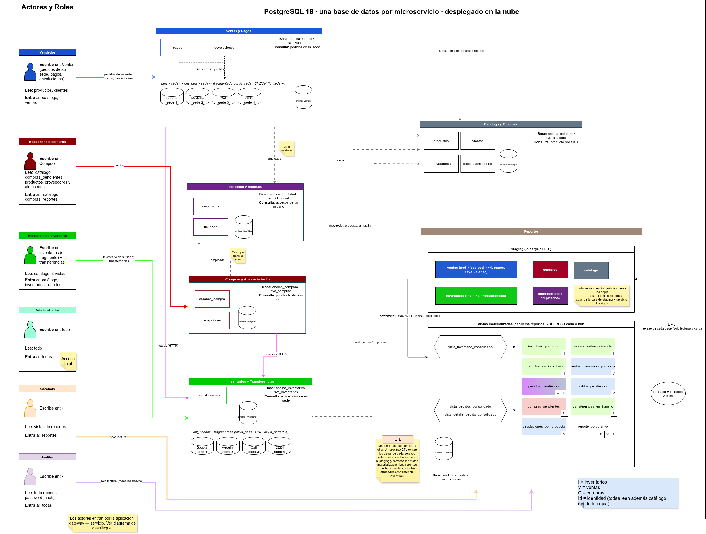
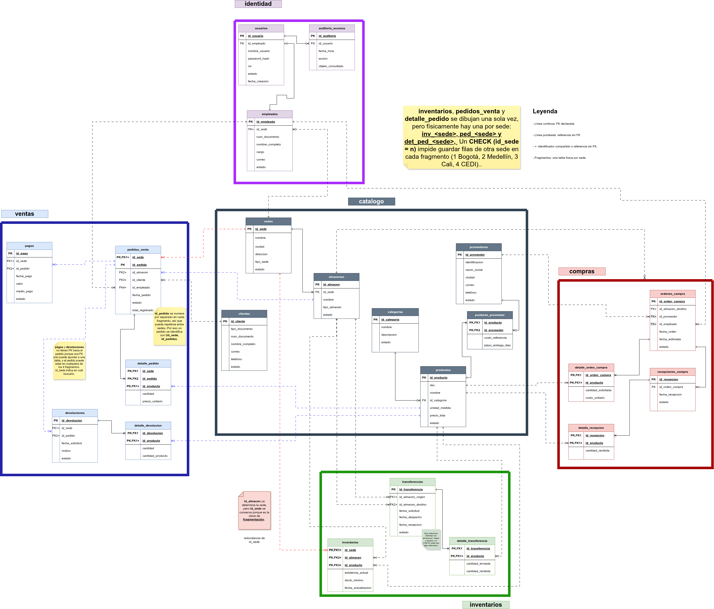

# bd-multisede-microservicios

Proyecto final de Bases de Datos. TL;DR: una empresa con **4 sedes** (Bogotá, Medellín, Cali y un centro de distribución en Funza) necesita una base de datos donde cada sede vea lo suyo y la gerencia vea todo junto. Todo hecho en **PostgreSQL** (el goat :3).

- El enunciado pide pensarlo como **microservicios**: catálogo, compras, inventarios, ventas, identidad y reportes. Aquí cada microservicio tiene **su propia base de datos** (`andina_catalogo`, `andina_ventas`…) y nadie más entra en ella. Como en PostgreSQL una consulta no puede leer otra base, un servicio no le puede meter la mano a los datos de otro.
- **Inventarios y pedidos están partidos por sede**: hay una tabla física por sede (`inv_bogota`, `ped_cali`…), cada una con un `CHECK (id_sede = n)` para que nadie meta filas donde no van.
- **Reportes** tiene su base con una **copia de solo lectura** de los demás servicios (se pasa con CSV), y encima de esa copia están las vistas que juntan los pedazos con `UNION ALL`.
- Hay **roles de verdad**: el vendedor de Bogotá no puede ni ver los pedidos de Cali, la gerencia solo entra a la base de reportes, el auditor lee todo pero no toca nada. Cada servicio tiene además su usuario técnico (`svc_ventas`…) que solo entra a su base.





## Ejecucion

Necesitas PostgreSQL (probado en la 18) y `psql`. Desde la carpeta del proyecto:

```bash
psql -U postgres -f run_all.sql
```

Eso borra todo, crea las 6 bases, mete los datos de prueba, arma la copia de reportes, corre las 20 consultas y las pruebas. Se puede correr las veces que quiera uno, siempre da lo mismo (semilla fija). Tiene que ser **desde la carpeta del proyecto** porque los CSV que se pasan entre bases quedan en `csv/`.

Sí, salen varios `ERROR`: son las pruebas de rechazo (SKU duplicado, permisos denegados, leer otra base…) y es justo lo que se espera. La salida completa está en [`docs/evidencias.txt`](docs/evidencias.txt).

Más detalle en el [manual](docs/manual-ejecucion.md).

## Estructura scripts

| Ruta | Qué es |
| --- | --- |
| `sql/README.md` | **qué hace cada script** y lo que no es SQL de clase (comandos de psql, trucos) |
| `sql/00_reset.sql`, `sql/01_bases.sql` | borra todo y crea las 6 bases |
| `sql/02`–`06` | tablas, un archivo por microservicio (también se usan para crear la copia en reportes) |
| `sql/07_datos_<servicio>.sql` | datos de prueba de cada servicio: 300 pedidos, 80 productos, 100 clientes… Totalmente generadas con IA :) |
| `sql/sync/` | cada servicio exporta sus tablas a CSV y reportes las importa |
| `sql/08_vistas.sql` | vistas que unen los fragmentos + las 10 vistas obligatorias (en la base de reportes) |
| `sql/09_roles.sql` | roles, usuarios y permisos, base por base |
| `sql/10_consultas.sql` | las 20 consultas que pide el enunciado |
| `sql/11_pruebas.sql` | pruebas de restricciones, fragmentos, permisos y aislamiento entre bases (todo con ROLLBACK, no ensucia nada) |
| `csv/` | archivos que genera `run_all.sql` para pasar datos entre bases (git los ignora) |
| `docs/enunciado.pdf` | Todo el contexto y requisitos que se nos dio para el proyecto |
| `docs/` | reglas de negocio, normalización, diccionario, manual, evidencias, diagramas |

## Proceso
- [x] Modelo E-R conceptual y modelo relacional
- [x] Base de datos completa: tablas, fragmentos, datos, vistas, roles, consultas y pruebas
- [x] Una base por microservicio + copia de lectura para reportes
- [x] Diagrama de arquitectura (una base por servicio + ETL hacia reportes)
- [ ] Reportes con ETL y vistas materializadas que se refrescan cada X minutos
- [ ] Diagrama de despliegue y ajustes del relacional
- [x] Normalización y diccionario de datos
- [ ] Análisis de resultados, conclusiones y matriz de pruebas para el informe
- [ ] Backend en Go (un proceso por microservicio + gateway) y un front básico
- [ ] Desplegar en la nube (AWS u otra opción gratuita)

## Notas

- **Solo SQL visto en clase.** Nada de secuencias, `NULLIF`, `GREATEST`/`LEAST` ni particionamiento declarativo. `COALESCE` es la única excepción (tengo que explicarlo en el informe xd).
- Las relaciones **entre** microservicios no tienen FK (una FK no puede apuntar a otra base). Son "identificadores compartidos" y se validan con `NOT EXISTS` en `11_pruebas.sql`, sobre la copia de reportes.
- La copia de reportes puede ir un poco atrasada respecto a cada servicio (se actualiza al sincronizar): eso es **consistencia eventual**, normal en microservicios.
