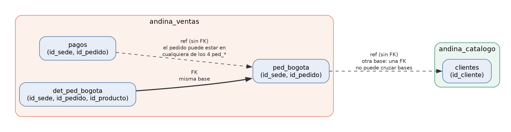
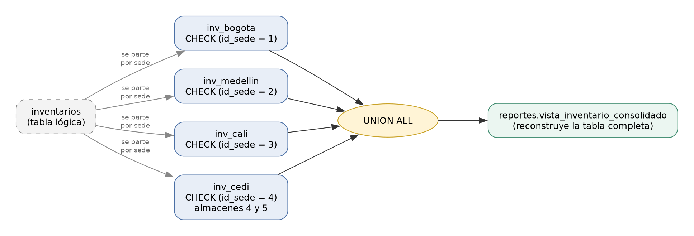
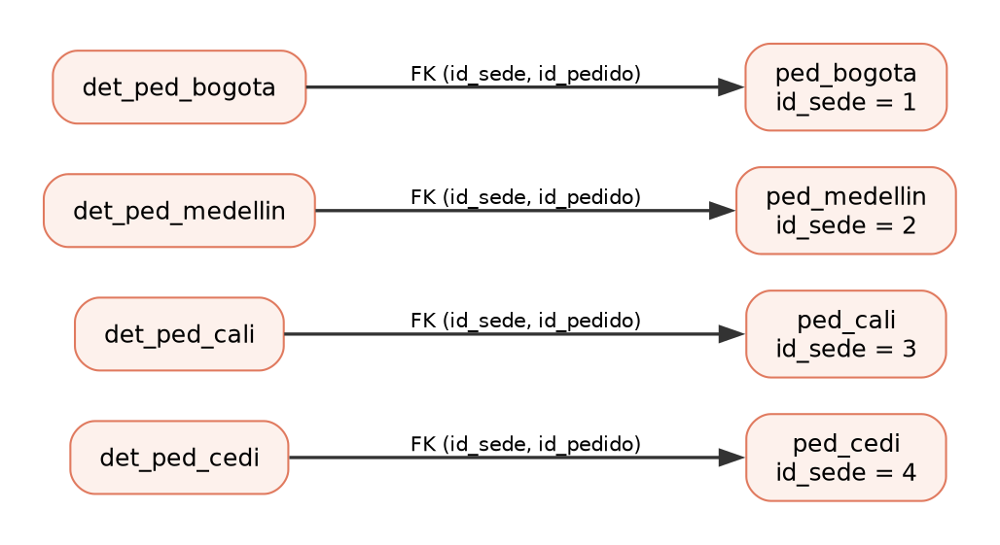

# Distribución de los datos

Proyecto final de Bases de Datos · Comercializadora Andina S.A.S.

Este documento es el **entregable 5**: qué bases y servicios hay, cómo se fragmentan los datos por
sede y cómo se vuelven a juntar para los reportes. Responde punto por punto lo que pide la sección
9.2 del enunciado.

**La idea en tres líneas:**
1. Cada microservicio tiene **su propia base de datos**.
2. Inventarios y pedidos se **parten por sede**: una tabla por sede.
3. **Reportes** junta todo con vistas que traen los datos de las otras bases.

---

## 1. Servicios y bases

Hay seis microservicios, y cada uno es **el único que escribe en su base**.

| Microservicio | Base | Qué guarda |
| --- | --- | --- |
| Catálogo y Terceros | `andina_catalogo` | sedes, almacenes, categorías, productos, proveedores, clientes |
| Identidad y Accesos | `andina_identidad` | empleados, usuarios, auditoría de accesos |
| Compras y Abastecimiento | `andina_compras` | órdenes de compra y recepciones |
| Inventarios y Transferencias | `andina_inventarios` | existencias **por sede** y transferencias |
| Ventas y Pagos | `andina_ventas` | pedidos **por sede**, pagos y devoluciones |
| Reportes Corporativos | `andina_reportes` | ninguna tabla: solo vistas de integración |

- Dentro de cada base hay un **esquema con el nombre del servicio**. Por eso una tabla se escribe
  `ventas.ped_bogota`.
- **Una consulta no puede leer otra base.** Eso es lo que hace que cada servicio sea dueño de sus
  datos de verdad. La única excepción es `dblink`, y solo la usa reportes (sección 4).
- Cada tabla deja escrito en la base qué servicio es su responsable, con `COMMENT ON TABLE`.

---

## 2. Cómo se relacionan los servicios



| Caso | ¿Hay FK? | Ejemplo |
| --- | --- | --- |
| Las dos tablas están **en la misma base** | Sí | el detalle de un pedido → su pedido |
| La tabla está **en otra base** | No: una FK no puede cruzar bases | el pedido → su cliente (en catálogo) |
| El destino está **fragmentado** | No: una FK apunta a una sola tabla | un pago → su pedido (en uno de los 4 fragmentos) |

Cuando no hay FK, la tabla guarda el id y nada más: es un **identificador compartido**. Que ese id
exista se revisa con `NOT EXISTS` en las pruebas ("prueba extra" de huérfanos: todas dan 0).

Los identificadores compartidos principales:

| Quien guarda el id | Columna | Apunta a |
| --- | --- | --- |
| identidad | `empleados.id_sede` | catálogo: sedes |
| compras | `id_proveedor`, `id_almacen_destino`, `id_producto` | catálogo |
| compras | `id_empleado` | identidad: empleados |
| inventarios | `id_sede`, `id_almacen`, `id_producto` | catálogo |
| ventas | `id_sede`, `id_almacen`, `id_cliente`, `id_producto` | catálogo |
| ventas | `id_empleado` | identidad: empleados |
| ventas | `pagos` y `devoluciones` → `(id_sede, id_pedido)` | el fragmento de pedidos de esa sede |

La lista completa, columna por columna, está en el [diccionario de datos](diccionario-datos.md)
(marca `ref`).

---

## 3. Fragmentación por sede

### Qué se fragmenta

Se fragmentan **dos conjuntos**, como pide el enunciado, más el detalle de los pedidos:

| Conjunto | Fragmentos | Base |
| --- | --- | --- |
| Inventarios | `inv_bogota`, `inv_medellin`, `inv_cali`, `inv_cedi` | `andina_inventarios` |
| Pedidos de venta | `ped_bogota`, `ped_medellin`, `ped_cali`, `ped_cedi` | `andina_ventas` |
| Detalle de pedido (derivado) | `det_ped_bogota`, `det_ped_medellin`, `det_ped_cali`, `det_ped_cedi` | `andina_ventas` |

Son **tablas físicas separadas**, no un filtro `WHERE`: cada sede tiene su propia tabla.



### Condición de fragmentación

Cada fragmento tiene un `CHECK` sobre la sede:

| Fragmento | Condición | Sede |
| --- | --- | --- |
| `inv_bogota`, `ped_bogota`, `det_ped_bogota` | `id_sede = 1` | Bogotá |
| `inv_medellin`, `ped_medellin`, `det_ped_medellin` | `id_sede = 2` | Medellín |
| `inv_cali`, `ped_cali`, `det_ped_cali` | `id_sede = 3` | Cali |
| `inv_cedi`, `ped_cedi`, `det_ped_cedi` | `id_sede = 4` | CEDI Funza |

### Cobertura de sedes

**Las cuatro sedes tienen su fragmento**, incluida la de distribución. Cada almacén cae en el
fragmento de su sede:

| Sede | Almacenes | Filas de inventario | Pedidos |
| --- | --- | --- | --- |
| 1 Bogotá | 1 | 72 | 100 |
| 2 Medellín | 2 | 69 | 80 |
| 3 Cali | 3 | 64 | 70 |
| 4 CEDI Funza | 4 y 5 (general y despacho) | 99 | 50 |

### Cómo se evita la duplicación

Una fila no puede quedar en dos fragmentos:
- **El `CHECK (id_sede = n)`** rechaza cualquier fila de otra sede. Si alguien intenta guardar
  inventario de Medellín en `inv_bogota`, la base da error (prueba 4b).
- Como cada fila tiene **una sola sede**, solo puede entrar en **un** fragmento.
- La prueba 5 lo comprueba: cada fragmento tiene una sola sede, y el `INTERSECT` entre dos
  fragmentos da 0 filas.

### Claves

| Fragmento | Clave primaria | Por qué |
| --- | --- | --- |
| `inv_*` | `(id_sede, id_almacen, id_producto)` | Un registro por sede, almacén y producto (RN-15) |
| `ped_*` | `(id_sede, id_pedido)` | **Cada sede numera sus pedidos desde 1**: puede haber un pedido 15 en Bogotá y otro 15 en Cali. El número solo no basta |
| `det_ped_*` | `(id_sede, id_pedido, id_producto)` | Un producto no se repite dentro de un pedido |

- Cada `ped_*` tiene **su propio contador** (`GENERATED ALWAYS AS IDENTITY`).
- `id_sede` es la **clave de fragmentación**: la columna sobre la que va el `CHECK`. En inventarios
  eso es una redundancia controlada (el almacén ya dice la sede), justificada en la
  [normalización](normalizacion.md), sección 4.1.

### Fragmentación derivada

El detalle se parte **igual que su pedido**: el detalle de un pedido de Bogotá va en
`det_ped_bogota`. Así cada detalle y su pedido están siempre juntos, y se pueden unir con una
**FK compuesta** `(id_sede, id_pedido)`.



### Consultas por sede y corporativas

Las dos cosas que pide el enunciado:

```sql
-- consulta local (una sede): se lee su fragmento, en la base del servicio
SELECT * FROM inventarios.inv_cali;                         -- en andina_inventarios

-- consulta corporativa (las cuatro sedes): la vista que junta los fragmentos
SELECT * FROM reportes.vista_inventario_consolidado;        -- en andina_reportes
```

---

## 4. Vistas de integración

Todo pasa en `andina_reportes`, que **no tiene tablas**, solo vistas.

### Cómo traen los datos: dblink

Como una consulta no puede leer otra base, reportes usa **`dblink`**: una extensión que ejecuta una
consulta en otra base y trae el resultado.

```sql
FROM dblink('srv_inventarios', 'SELECT id_sede, id_almacen, ... FROM inventarios.inv_cali')
     AS i(id_sede INTEGER, id_almacen INTEGER, ...)
```

Solo reportes conserva `dblink`. Los demás servicios lo usan para armar sus datos de prueba y se lo
quitan al terminar.

### Vistas materializadas

Las vistas de reportes son **materializadas**: ejecutan su consulta y **guardan el resultado**.
Se actualizan con `REFRESH` cada X minutos (`sql/05_reportes/refrescar.sql`, programado con cron).

- Leer un reporte no va por `dblink` a las otras bases cada vez.
- Si una base se cae, el reporte sigue mostrando lo último que guardó.
- El costo: entre un refresco y otro el reporte puede ir un poco atrasado (**consistencia
  eventual**). El enunciado dice que no hace falta tiempo real.

### Las vistas unificadas (una por conjunto fragmentado)

Reconstruyen la tabla completa juntando los 4 fragmentos con **`UNION ALL`**:

| Vista | Junta |
| --- | --- |
| `vista_inventario_consolidado` | `inv_bogota` + `inv_medellin` + `inv_cali` + `inv_cedi` |
| `vista_pedidos_consolidado` | los 4 `ped_*` |
| `vista_detalle_pedido_consolidado` | los 4 `det_ped_*` |

- **`UNION ALL` y no `UNION`:** `UNION` busca y quita repetidos, y aquí no puede haber (el `CHECK` ya
  lo impide). Sería trabajo perdido.
- **Procedencia:** cada fila trae una columna `fragmento` que dice de qué base y tabla viene, por
  ejemplo `andina_ventas.ped_cali`.

### Las 10 vistas del enunciado

Se construyen encima de las unificadas, y traen de catálogo o identidad lo que necesitan (nombres,
precios) por `dblink`:

| Vista | De dónde vienen los datos |
| --- | --- |
| 1. `vista_inventario_por_sede` | inventarios + catálogo |
| 2. `vista_alertas_reabastecimiento` | inventarios + catálogo |
| 3. `vista_productos_sin_inventario` | catálogo + inventarios |
| 4. `vista_ventas_mensuales_por_sede` | ventas + catálogo |
| 5. `vista_pedidos_pendientes` | ventas + catálogo + identidad |
| 6. `vista_saldos_pendientes` | ventas (pedidos y pagos) + catálogo |
| 7. `vista_compras_pendientes` | compras + catálogo |
| 8. `vista_transferencias_en_transito` | inventarios + catálogo |
| 9. `vista_devoluciones_por_producto` | ventas (pedidos y devoluciones) + catálogo |
| 10. `vista_reporte_corporativo` | todos los servicios |

La procedencia también queda guardada en la base, con `COMMENT ON MATERIALIZED VIEW` (se ve con
`\dm+ reportes.*`).

---

## 5. Lo que hay que tener en cuenta

- **dblink acopla reportes a los demás servicios:** si catálogo cambia una columna, las vistas de
  reportes se rompen. Es la versión más simple de explicar. La alternativa donde ninguna base se
  conecta a otra (un ETL por CSV) está en la rama `feat/microservicios-reales`.
- **Las 6 bases están en el mismo servidor PostgreSQL.** Los datos están aislados (ninguna base lee
  otra sin dblink), pero la infraestructura es compartida. Separarlas en servidores distintos solo
  cambia a dónde se conecta cada script.
- **Lo que la base no impone sola** (los identificadores compartidos, que el almacén sea de la sede
  de la fila…) se revisa con `NOT EXISTS` en `sql/08_pruebas/`.

**Para ver el detalle:**
- [Diccionario de datos](diccionario-datos.md)
- [Normalización](normalizacion.md)
- [`sql/02_tablas/`](../sql/02_tablas/README.md), cómo se crean los fragmentos
- [`sql/05_reportes/`](../sql/05_reportes/README.md), cómo funcionan las vistas
